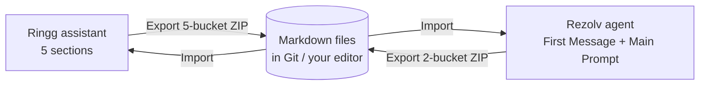

<div align="center">

# PromptPort

**Export, import and find-and-replace voice-bot prompts as clean Markdown — right inside Ringg AI and Rezolv.AI.**

Back up a bot in one click. Move a prompt between assistants or between platforms. Review every change before it touches the page.


[Install](#install) · [Features](#features) · [Supported sites](#supported-sites) · [How it works](#how-it-works) · [FAQ](#faq)

</div>

<!-- Tip: add a screenshot or short GIF of the panel here, e.g.  -->

---

## Why PromptPort?

A production voice bot lives in a handful of text boxes on a web dashboard: a first message, an objective, response guidelines, a conversation script, FAQs. Tens of thousands of characters of carefully tuned instructions, with no history, no diff, and no easy way to copy them anywhere else.

Prompt teams end up copy-pasting between tabs, losing formatting, breaking variable chips, and hoping nobody overwrote last week's fix.

**PromptPort turns those text boxes into files.** Export the whole bot as Markdown, keep it in Git, edit it in any editor, and import it back — with a line-by-line review, an automatic backup and one-click Undo.

---

## Supported sites

| Platform | Where it runs | What it reads and writes |
| --- | --- | --- |
| **Ringg AI** | Assistant pages on `*.ringg.ai` | 5 sections: First Message, Objective, Response Guidelines, Conversation Script, FAQs |
| **Rezolv.AI Voicebot Panel** | Voice-agent Prompt tab on `panels.gorezolv.com/voicebot/` | 2 fields: First Message, Main Prompt |

The extension only activates on these two sites. It has no access to any other page.

---

## Who it's for

- **Prompt engineers and conversation designers** who iterate on voice-bot prompts every day.
- **Collections, sales and support bot teams** running many bots that share the same building blocks.
- **Agencies and implementation teams** who set up the same bot for several clients or move bots between platforms.
- **Reviewers and QA** who want to see exactly what changed before a prompt goes live.
- **Team leads** who want prompts in version control instead of only on a dashboard.

---

## Features

### Export in one click
- **5-bucket ZIP** — one Markdown file per section: `1_First_Message.md`, `2_Objective.md`, `3_Response_Guidelines.md`, `4_Conversation_Flow.md`, `5_FAQs.md`.
- **2-bucket ZIP** — `1_First_Message.md` + `2_Main_Prompt.md`, with the four prompt sections under `# Objective`, `# Response Guidelines`, `# Conversation Flow` and `# FAQs` headings.
- Both formats work on both sites. The ZIP is named after your assistant, so backups never get mixed up.
- Formatting comes across faithfully: headings, bold, lists, numbered steps, tables, line breaks and Hindi / Devanagari text.
- **Variables stay variables.** Chips such as `@{{customer_name}}` export as text you can read and edit.

### Import safely
- Drop a **.zip** or a single **.md** file onto the panel.
- PromptPort recognises the format by itself — 5-bucket, 2-bucket, a single section, or a file with section headings — and maps it to the right fields.
- **You see the diff first.** Every field shows lines added and removed, with a "See changes" view. Fields that already match are skipped.
- Nothing is overwritten until you press **Confirm import**, and nothing is saved until **you** press Save on the page.
- `@{{variables}}` in your file become real variable chips in the editor.

### Undo anything
- An **automatic backup** is taken right before every import.
- **Undo import** restores the exact previous content — even after you've switched tabs or closed the panel.
- If you edited a field after importing, PromptPort warns you before Undo replaces those edits.
- **Download backup** saves the "before" version as a ZIP.

### Move bots between platforms
- Import a **Ringg 5-bucket export into Rezolv** and the four prompt sections are combined into Main Prompt under `#` headings.
- Import a **2-bucket file into Ringg** and Main Prompt is split back into the four sections by its headings.
- Import only one section (for example, just FAQs) and only that part changes — on Rezolv, the other `#` sections inside Main Prompt are kept.



### Find & replace across the whole bot
- Search every section at once, with live yellow highlights on the page and a match counter.
- **Match case** and **Whole word** — whole-word matching understands Hindi and other Indian scripts, so `जी` won't match inside another word.
- Jump between matches with **Enter / Shift+Enter**.
- **Replace all** rewrites every matching field in one go. Variable chips are protected, so a replace never renames a variable.

### Private by design
- Runs entirely in your browser. **No servers, no analytics, no tracking.** Your prompts are never sent anywhere.
- Only activates on the two supported sites.
- Never clicks Save for you.

---

## Install

PromptPort is a standard Chrome (Manifest V3) extension. It should also load in other Chromium browsers such as Edge and Brave (tested on Chrome).

1. Download the latest ZIP from [**Releases**](../../releases) and unzip it into a folder you'll keep.
2. Open `chrome://extensions` and switch on **Developer mode** (top right).
3. Click **Load unpacked** and select the unzipped folder.
4. Open an assistant on Ringg AI or a voice agent's Prompt tab on Rezolv.AI. The PromptPort button appears in the bottom-right corner.

> **Work laptop with managed extensions?** Ask your IT admin to allow the extension. The [permissions](#permissions) section below is written for them.

---

## How it works

### Export
1. Open the assistant (Ringg) or the agent's **Prompt** tab (Rezolv).
2. Click the **PromptPort** button in the bottom-right corner.
3. Choose **Download 5 Buckets** or **Download 2 Buckets**.

> On Rezolv, **Download 5 Buckets** switches on once Main Prompt is organised under `# Objective`, `# Response Guidelines`, `# Conversation Flow` and `# FAQs`. The panel shows which headings it found and which are missing.

### Import
1. Open the **Import** tab and drop a `.zip` or `.md` file (or click to choose one).
2. Review the diff for each field.
3. Click **Confirm import**.
4. Check the page, then press **Save** on the site to keep the changes — or **Undo import** to go back.

### Find & replace
1. Open the **Find** tab and type. Matches highlight as you type.
2. Optionally fill **Replace with** and click **Replace all**.
3. Review, then press **Save** on the site.

---

## File format

**5-bucket ZIP**
```text
My Assistant.zip
├── 1_First_Message.md
├── 2_Objective.md
├── 3_Response_Guidelines.md
├── 4_Conversation_Flow.md
└── 5_FAQs.md
```

**2-bucket ZIP**
```text
My Assistant (2-bucket).zip
├── 1_First_Message.md
└── 2_Main_Prompt.md
```

**`2_Main_Prompt.md`**
```markdown
# Objective

Remind the customer about the upcoming EMI and get a clear commitment.

# Response Guidelines

- Speak in Hinglish, short turns
- Never threaten

# Conversation Flow

**Step 1:** Greet @{{customer_name}} and confirm identity.
**Step 2:** Mention the due date @{{due_date}}.

# FAQs

**Q:** Can I pay later?
**A:** Please pay before @{{due_date}} to avoid charges.
```

Writing files by hand? A line break you type stays a line break, and `@{{variable}}` becomes a variable chip on import.

---

## Permissions

| Permission | Why it's needed |
| --- | --- |
| `clipboardRead`, `clipboardWrite` | Copies each section exactly as the site's editor formats it (variables, tables, lists). Your clipboard is put back afterwards. |
| `activeTab`, `scripting` | Lets the toolbar popup check the current page and open the panel. |
| Host access to `*.ringg.ai` and `panels.gorezolv.com` | The only two sites the extension runs on. |

On Ringg, a small page script notices the assistant data the dashboard already loads, which helps name your ZIP files. It only ever repeats read-only requests, never a save.

---

## FAQ

**Does PromptPort save anything to Ringg or Rezolv?**
No. It writes into the editor on the page, exactly as if you had pasted it. You review it and press Save yourself.

**What if an import goes wrong?**
Click **Undo import** — on the results screen or later from the Import tab. Every import is backed up first, and you can download that backup as a ZIP.

**Will my variables survive?**
Yes. Chips export as `@{{name}}` and come back as real chips on import. Find & replace never edits a chip's name.

**Can I copy a bot from Ringg to Rezolv?**
Yes. Export a 5-bucket ZIP from Ringg and import it on Rezolv. The sections are combined into Main Prompt under `#` headings. It works the other way too.

**Does it work with Hindi and other Indian languages?**
Yes. Export, import and whole-word search handle Devanagari and other Unicode scripts.

**Is my data sent anywhere?**
No. There is no server, no analytics and no tracking. Everything happens in your browser.

---

## Good to know

- PromptPort reads the editors on the page, so a large redesign of either dashboard could need an update. Please [open an issue](../../issues) if something stops working.
- On Ringg, re-importing a list can change its spacing class in the editor. The text and the exported Markdown are unaffected.
- Collapsed sections on Ringg are opened automatically before reading.

---

## Roadmap ideas

- One-click "compare two assistants"
- Export history inside the panel
- Firefox support

Ideas and pull requests are welcome.

---

## Contributing

1. Fork the repo and create a branch.
2. Load your copy with **Load unpacked** and test on both supported sites.
3. Open a pull request describing what changed and how you tested it.

---

## Disclaimer

PromptPort is an independent, community-built tool. It is not affiliated with, endorsed by, or sponsored by Ringg AI or Rezolv.AI. Product names are used only to describe compatibility, and all trademarks belong to their owners.

---

## License

[MIT](LICENSE) — free to use, modify and share.

<div align="center">

Built by **Raj Savla** · [LinkedIn](https://www.linkedin.com/in/rbsavla/) · [GitHub](https://github.com/rbsavla24)

If PromptPort saves you time, star the repo so other prompt teams can find it.

</div>
