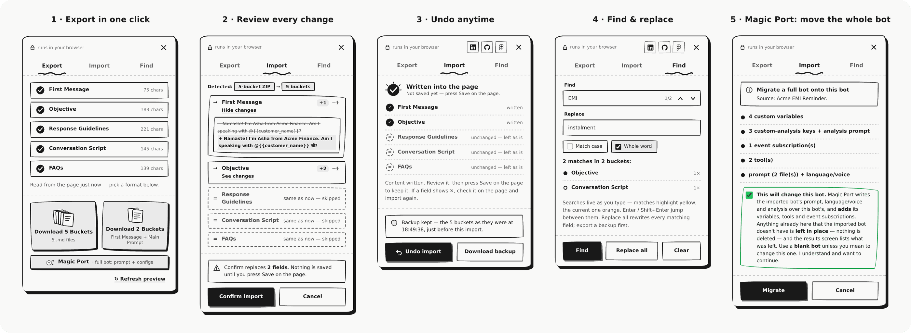
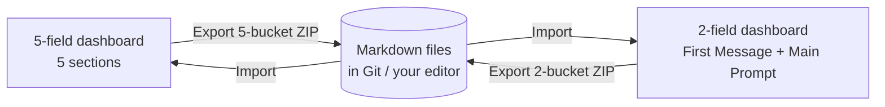
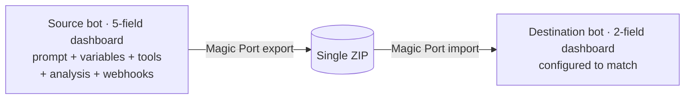

<div align="center">

# PromptPort

**Export, import and find-and-replace voice-bot prompts as clean Markdown — right inside your voice-bot dashboard.**

Back up a bot in one click. Move a prompt between assistants or between platforms. Review every change before it touches the page.


[Install](#install) · [Features](#features) · [Magic Port](#magic-port--move-the-whole-bot-not-just-the-prompt) · [Supported sites](#supported-sites) · [How it works](#how-it-works) · [FAQ](#faq)

</div>

<p align="center">
  
</p>

---

## Why PromptPort?

A production voice bot lives in a handful of text boxes on a web dashboard: a first message, an objective, response guidelines, a conversation script, FAQs. Tens of thousands of characters of carefully tuned instructions, with no history, no diff, and no easy way to copy them anywhere else.

Prompt teams end up copy-pasting between tabs, losing formatting, breaking variable chips, and hoping nobody overwrote last week's fix.

**PromptPort turns those text boxes into files.** Export the whole bot as Markdown, keep it in Git, edit it in any editor, and import it back — with a line-by-line review, an automatic backup and one-click Undo.

---

## Supported sites

| Platform | Where it runs | What it reads and writes |
| --- | --- | --- |
| **5-field dashboard** | Assistant pages of the supported 5-field dashboard | 5 sections: First Message, Objective, Response Guidelines, Conversation Script, FAQs |
| **2-field dashboard** | Voice-agent pages of the supported 2-field dashboard (production and QA) | 2 prompt fields: First Message, Main Prompt. With Magic Port also: custom variables, language, custom analysis, on-call tools and event subscriptions |

The extension only activates on these two sites. It has no access to any other page.

---

## Who it's for

- **Prompt engineers and conversation designers** who iterate on voice-bot prompts every day.
- **Collections, sales and support bot teams** running many bots that share the same building blocks.
- **Agencies and implementation teams** who set up the same bot for several clients or move bots between platforms.
- **Reviewers and QA** who want to see exactly what changed before a prompt goes live.
- **Team leads** who want prompts in version control instead of only on a dashboard.

---

## Features

### Export in one click
- **5-bucket ZIP** — one Markdown file per section: `1_First_Message.md`, `2_Objective.md`, `3_Response_Guidelines.md`, `4_Conversation_Flow.md`, `5_FAQs.md`.
- **2-bucket ZIP** — `1_First_Message.md` + `2_Main_Prompt.md`, with the four prompt sections under `# Objective`, `# Response Guidelines`, `# Conversation Flow` and `# FAQs` headings.
- Both formats work on both sites. The ZIP is named after your assistant, so backups never get mixed up.
- Formatting comes across faithfully: headings, bold, lists, numbered steps, tables, line breaks and Hindi / Devanagari text.
- **Variables stay variables.** Chips such as `@{{customer_name}}` export as text you can read and edit.

### Import safely
- Drop a **.zip** or a single **.md** file onto the panel.
- PromptPort recognises the format by itself — 5-bucket, 2-bucket, a single section, or a file with section headings — and maps it to the right fields.
- **You see the diff first.** Every field shows lines added and removed, with a "See changes" view. Fields that already match are skipped.
- Nothing is overwritten until you press **Confirm import**, and nothing is saved until **you** press Save on the page.
- `@{{variables}}` in your file become real variable chips in the editor.

### Undo anything
- An **automatic backup** is taken right before every import.
- **Undo import** restores the exact previous content — even after you've switched tabs or closed the panel.
- If you edited a field after importing, PromptPort warns you before Undo replaces those edits.
- **Download backup** saves the "before" version as a ZIP.

### Move bots between platforms
- Import a **5-bucket export into a 2-field dashboard** and the four prompt sections are combined into Main Prompt under `#` headings.
- Import a **2-bucket file into a 5-field dashboard** and Main Prompt is split back into the four sections by its headings.
- Import only one section (for example, just FAQs) and only that part changes — on a 2-field dashboard, the other `#` sections inside Main Prompt are kept.



### Magic Port — move the whole bot, not just the prompt

Everything above moves *prompt text*. **Magic Port** moves a bot's **configuration** as well: export a complete bot from a 5-field dashboard as a single ZIP, then import it into a bot on a 2-field dashboard.

| What moves | Notes |
| --- | --- |
| **Prompt** (First Message, Main Prompt) | Travels as the same Markdown buckets the normal export uses |
| **Custom variables** | Created on the destination. The source has no type on variables, so they arrive as `String` |
| **Language** | Primary and secondary, mapped from locale codes to the destination's language names (`hi-IN` → Hindi) |
| **Custom analysis** | The system prompt plus the required keys, each with its type (`String` / `Number` / `Boolean` / `String[]`) |
| **Tools** | On-call API tools: method, URL, headers, query, path and body rows, including variables bound through the picker |
| **Event subscriptions** | Each webhook URL with its events |

**What it does *not* move**, by design or by platform limit:

- **Voice and speaking speed** are not ported — only the languages.
- **Pre-call and post-call tools cannot be migrated.** The destination dashboard currently shows *"Coming soon."* for both phases and offers no way to add an API there, so a bot whose tools are all pre-call migrates zero tools. Every skipped tool is listed by name on the results screen rather than silently dropped. If the destination enables those phases, Magic Port will use them without needing a code change.
- **Non-API tools** — callback-schedule, calendar, form, quick-reply and WhatsApp widgets — have no equivalent on the destination and are reported as out of scope.

**It adds; it does not delete.** Variables, tools and subscriptions already on the destination that the source doesn't have are left exactly where they are, and listed in the results so you can see the difference. Nothing is ever removed from the destination bot.

**Magic Port does press Save.** Unlike the prompt import, it commits each section as it goes — that's the only way a configuration import can work. Use a **blank bot** unless you mean to change an existing one; the import is gated behind a consent checkbox that says so.

> **The ZIP can contain credentials.** A tool's headers travel as written, so an `Authorization` header comes across with its value. The export is labelled accordingly — treat the file like a secret, and don't commit it to a public repo.



### Find & replace across the whole bot
- Search every section at once, with live yellow highlights on the page and a match counter.
- **Match case** and **Whole word** — whole-word matching understands Hindi and other Indian scripts, so `जी` won't match inside another word.
- Jump between matches with **Enter / Shift+Enter**.
- **Replace all** rewrites every matching field in one go. Variable chips are protected, so a replace never renames a variable.

### Private by design
- Runs entirely in your browser. **No servers, no analytics, no tracking.** Your prompts are never sent anywhere.
- Only activates on the supported sites.
- The prompt import never clicks Save for you — you review it and save it yourself. **Magic Port is the exception**: a configuration import has to commit each section as it goes, so it saves on your behalf, behind a consent checkbox.

---

## Install

PromptPort is a standard Chrome (Manifest V3) extension. It should also load in other Chromium browsers such as Edge and Brave (tested on Chrome).

1. Download `PromptPort-v3.2.4.zip` from [**Releases**](../../releases/latest) and unzip it into a folder you'll keep.
   *(Or clone this repository and use the `extension` folder.)*
2. Open `chrome://extensions` and switch on **Developer mode** (top right).
3. Click **Load unpacked** and select the unzipped folder (the one containing `manifest.json`).
4. Open an assistant on the 5-field dashboard, or a voice agent's Prompt tab on the 2-field dashboard. The PromptPort button appears in the bottom-right corner.

> **Work laptop with managed extensions?** Ask your IT admin to allow the extension. The [permissions](#permissions) section below is written for them.

---

## How it works

### Export
1. Open the assistant (5-field dashboard) or the agent's **Prompt** tab (2-field dashboard).
2. Click the **PromptPort** button in the bottom-right corner.
3. Choose **Download 5 Buckets** or **Download 2 Buckets**.

> On a 2-field dashboard, **Download 5 Buckets** switches on once Main Prompt is organised under `# Objective`, `# Response Guidelines`, `# Conversation Flow` and `# FAQs`. The panel shows which headings it found and which are missing.

### Import
1. Open the **Import** tab and drop a `.zip` or `.md` file (or click to choose one).
2. Review the diff for each field.
3. Click **Confirm import**.
4. Check the page, then press **Save** on the site to keep the changes — or **Undo import** to go back.

### Magic Port
1. On the 5-field dashboard, open the assistant you want to copy, open the panel and click **Magic Port**. You get one ZIP holding the prompt and the configuration.
2. On the 2-field dashboard, open the destination agent — ideally a **blank** one — and drop that ZIP into the **Import** tab.
3. Read the summary: it lists what will be migrated and what won't (non-API tools, pre/post-call tools).
4. Tick the consent box and confirm. Magic Port works through the agent's tabs, saving each section as it finishes.
5. Read the results screen. Anything it could not write is listed by name — nothing fails silently.

> Unlike a prompt import, this one presses **Save** for you, and there is no one-click undo for configuration. Rehearse on a blank bot.

### Find & replace
1. Open the **Find** tab and type. Matches highlight as you type.
2. Optionally fill **Replace with** and click **Replace all**.
3. Review, then press **Save** on the site.

---

## File format

**5-bucket ZIP**
```text
My Assistant.zip
├── 1_First_Message.md
├── 2_Objective.md
├── 3_Response_Guidelines.md
├── 4_Conversation_Flow.md
└── 5_FAQs.md
```

**2-bucket ZIP**
```text
My Assistant (2-bucket).zip
├── 1_First_Message.md
└── 2_Main_Prompt.md
```

**`2_Main_Prompt.md`**
```markdown
# Objective

Remind the customer about the upcoming EMI and get a clear commitment.

# Response Guidelines

- Speak in Hinglish, short turns
- Never threaten

# Conversation Flow

**Step 1:** Greet @{{customer_name}} and confirm identity.
**Step 2:** Mention the due date @{{due_date}}.

# FAQs

**Q:** Can I pay later?
**A:** Please pay before @{{due_date}} to avoid charges.
```

Writing files by hand? A line break you type stays a line break, and `@{{variable}}` becomes a variable chip on import.

---

## Permissions

| Permission | Why it's needed |
| --- | --- |
| `clipboardRead`, `clipboardWrite` | Copies each section exactly as the site's editor formats it (variables, tables, lists). Your clipboard is put back afterwards. |
| `activeTab`, `scripting` | Lets the toolbar popup check the current page and open the panel. |
| Host access to the supported dashboards (listed in `manifest.json`) | The only sites the extension runs on. A QA host is included so a migration can be rehearsed before touching production. |

On the 5-field dashboard, a small page script notices the assistant data the dashboard already loads, which helps name your ZIP files. It only ever repeats read-only requests, never a save.

---

## FAQ

**Does PromptPort save anything to the dashboard?**
For a prompt import, no — it writes into the editor exactly as if you had pasted it, and you review it and press Save yourself. **Magic Port is different**: it migrates a whole configuration, so it has to press Save for you, section by section. That import asks you to tick a consent box first, and it only ever adds — it never deletes anything already on the destination bot.

**What if an import goes wrong?**
Click **Undo import** — on the results screen or later from the Import tab. Every import is backed up first, and you can download that backup as a ZIP.

**Will my variables survive?**
Yes. Chips export as `@{{name}}` and come back as real chips on import. Find & replace never edits a chip's name.

**Can I copy a bot from a 5-field dashboard to a 2-field dashboard?**
Yes. Export a 5-bucket ZIP from the 5-field dashboard and import it on the 2-field dashboard. The sections are combined into Main Prompt under `#` headings. It works the other way too.

**Can Magic Port copy my pre-call tools?**
Not today, and not because of the extension. The destination dashboard shows *"Coming soon."* for both the Pre Call and Post Call phases and gives no way to add an API there, so those tools have nowhere to go. They are listed by name on the results screen so you know exactly what was left behind. When the destination enables those phases, Magic Port picks them up automatically.

**What happens if the destination bot already has variables or webhooks?**
They stay. Magic Port adds and updates; it never deletes. Anything on the destination that isn't in the source is reported back to you as "left in place" so you can decide what to do with it.

**Is the Magic Port ZIP safe to share?**
Treat it as a secret. Tool headers travel as written, so an `Authorization` header comes across with its value, and the file is labelled as containing credentials. Don't commit one to a public repo.

**Does it work with Hindi and other Indian languages?**
Yes. Export, import and whole-word search handle Devanagari and other Unicode scripts.

**Is my data sent anywhere?**
No. There is no server, no analytics and no tracking. Everything happens in your browser.

---

## Good to know

- PromptPort reads the editors on the page, so a large redesign of either dashboard could need an update. Please [open an issue](../../issues) if something stops working.
- On the 5-field dashboard, re-importing a list can change its spacing class in the editor. The text and the exported Markdown are unaffected.
- Collapsed sections on the 5-field dashboard are opened automatically before reading.
- Magic Port reads back everything it writes and re-checks it, because the destination dashboard renders some lists a moment behind its own backend. Anything it could not confirm is named on the results screen instead of being reported as done.
- Rehearse a migration on a blank bot first. Magic Port adds rather than replaces, so importing twice into the same bot is safe for tools and webhooks, but variables will accumulate.

---

## Roadmap ideas

- Magic Port in the 2-field → 5-field direction (today it is 5-field → 2-field only)
- Porting voice and speaking speed alongside the languages
- One-click "compare two assistants"
- Export history inside the panel
- Firefox support

Ideas and pull requests are welcome.

---

## Contributing

1. Fork the repo and create a branch.
2. Load your copy with **Load unpacked** and test on both supported sites.
3. Open a pull request describing what changed and how you tested it.

---

## Disclaimer

PromptPort is an independent, community-built tool. It is not affiliated with, endorsed by, or sponsored by any voice-bot platform, and all trademarks belong to their owners.

---

## License

[MIT](LICENSE) — free to use, modify and share.

<div align="center">

Built by **Raj Savla** · [LinkedIn](https://www.linkedin.com/in/rbsavla/) · [GitHub](https://github.com/rbsavla24)

If PromptPort saves you time, star the repo so other prompt teams can find it.

</div>
